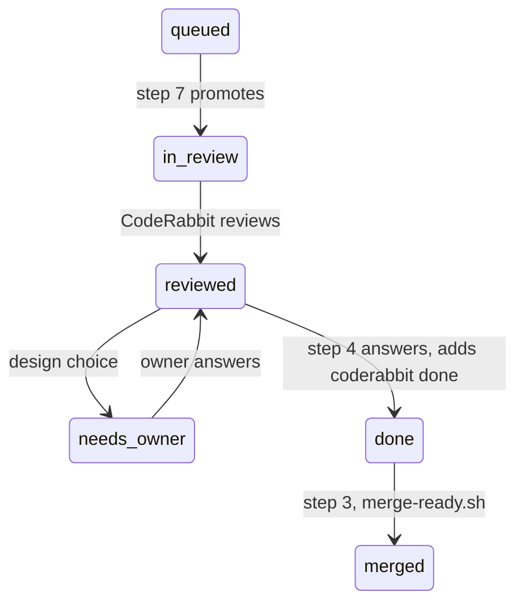

# The PR steward runs as a Conductor routine

2026-10-13 · Thomas C. King

An hourly agent takes the owner's PRs from a checked draft to a merge. It marks the draft
ready, lets CodeRabbit review it once, answers the findings, and merges the PR after a
person approves it and CI is green. It also approves and merges green Dependabot PRs. The
process is `.claude/skills/pr-steward/SKILL.md`. This document is the design behind it.

The design comes from the PR steward of `transition-zero/tz-ps-composer`
(`docs/specs/2026-09-30-pr-steward-design.md` in that repository). That steward is a Claude
Code cloud routine. This one is a Conductor routine. `2026-10-13-nightly-routine-design.md`
defines the words "Conductor routine", "trigger" and "owner", and says what a Conductor
workspace gives the agent.

## Team use

- **One routine for each person.** Each person who wants a steward creates their own. It
  works only on that person's PRs with the `PR Ready` label. It keeps its own tracker issue,
  `PR steward · @<login>`, with its own lock.
- **One Dependabot owner.** `.claude/skills/pr-steward/dependabot-owner` holds one login.
  Only that person's steward approves and merges Dependabot PRs.
- **The steward never touches another person's PR.**

## What the steward merges

- **A green Dependabot PR,** with no person. The steward approves it in the owner's name,
  then merges it.
- **One of the owner's PRs,** when all of these are true:
  - The PR has `PR Ready`, and its base is `main`.
  - A person other than the owner approved the head commit.
  - No reviewer requests changes.
  - The PR has `coderabbit done`.
  - Every check is green, and the checks include `lint` and a Windows test leg.
  - No review thread is open, and GitHub says that the PR can merge.

So a teammate approves, and the next hourly run merges. The nightly routine merges nothing.

## Lanes

The source steward filtered PRs by labels and author again in each step, and the filters
did not agree. Here `lane.sh` gives each open PR one lane, and each step names its lanes:

The other lanes are `foreign`, `held`, `owner-work` and `dependabot`. `merge-ready.sh` and
`promote.sh` take the lane as input, so the author and label rules are in one script.

## One run

The steps follow the source design. The changes are:

1. **Lock.** A comment marker on the tracker, with a 55-minute expiry. The source steward
   reused one marker comment by editing it. GitHub has no conditional edit, so two runs
   that edit one comment can both believe they hold it. Here each run posts a marker of its
   own, reads the comments again, and continues only when the oldest live marker is its own
   (`lock.sh mine`). GitHub gives comment ids in order, so exactly one run wins. A run
   deletes its marker when it ends.
2. **Dependabot.** The organisation ruleset for public repositories has
   `dismiss_stale_reviews_on_push` and `require_last_push_approval`. When the steward pushes
   a fix to a red Dependabot PR, the owner becomes the last pusher. The owner's approval
   then does not count, and a teammate must approve. The steward adds `needs owner review`
   and mentions this in its comment.
3. **Merge.** `gh pr merge --squash --match-head-commit <sha>`. GitHub refuses the merge if
   the head moved after the last check.
4. **The push.** The source spent one push budget across four steps, and stated no rule
   for which PR wins. Here the run chooses one PR by a stated order: findings to answer,
   then red CI in the PR's code, then a conflict, then a person's small ask. It does all
   of that PR's work in one worktree, and pushes one time. A PR under review takes `main`
   by a merge, not a rebase.
5. **Comments on other PRs.** A larger ask gets a proposal and `needs owner`. A small ask
   waits for its PR's turn at step 4.
6. **Red CI on other PRs.** A re-run of a flake, a note for a check that is red on `main`,
   or `needs owner` after a steward fix that stays red. No push.
7. **Promote.** `gh pr ready <n>`. The source steward could not do this, so it added a
   `steward:promote` label and a workflow marked the draft ready. Neither exists here. The
   run reads each queued draft's `mergeable_state` once, with `pull.sh`, and gives the
   states to `promote.sh`.
8. **Merge risk.** No change.
9. **Report.** No change.
10. **Archive.** The run archives its own Conductor workspace.

The CodeRabbit pause is one rule in the skill's "GitHub" section, checked by
`coderabbit.sh paused`. `/stack` uses the same rule and the same 3-minute wait.

## The CodeRabbit allowance

The source steward assumed one CodeRabbit review an hour. On this repository, CodeRabbit's
notes gave other numbers:

| PR | CodeRabbit's note |
| --- | --- |
| #17 | "Your plan provides up to 10 included reviews per hour" |
| #53 | "…set your current allowance at 5 reviews per hour" |
| #59 | "…set your current allowance at 4 reviews per hour" |

`coderabbit.sh slot` reads the allowance from the newest note on the owner's PRs. It uses
one review an hour when no note matches. The slot is free while the owner has fewer reviews
in the last hour than the allowance.

## Labels

| Label | Set by | Means |
| --- | --- | --- |
| `PR Ready` | the owner | the steward can mark this draft ready and get it reviewed |
| `coderabbit done` | the steward | CodeRabbit reviewed it once, the findings have answers, and reviews are paused |
| `needs owner` | the steward | a design choice or a larger ask waits for the owner |
| `needs owner review` | the steward | the steward pushed a fix to a Dependabot PR |
| `decided-by-bot` | the steward | the PR body records a Minor decision that the steward made |
| `merge-risk:minimal` to `merge-risk:critical` | the steward | CodeRabbit's merge risk rating |

## The routine in Conductor

| Field | Value |
| --- | --- |
| Name | `tz-oss-interop PR steward` |
| Project | `tz-oss-interop` |
| Agent and model | `claude`, `opus-5-5-1m`, effort `high` |
| Triggers | `webhook` (from the API), and `cron` `5 7-19 * * 1-5` UTC (added in the app) |
| Prompt | run `/pr-steward`, with the `mode` from the webhook body as the argument |

## Decisions

- **D1. The owner** of both routines is `thomaschristopherking`. The steward's PRs show that
  person as the author, so that person cannot approve them.
- **D3. The time** is `5 7-19 * * 1-5` UTC: each weekday hour from 07:05 to 19:05. Nobody
  approves at night, so a night run has nothing to merge.
- **D4. The allowance** comes from CodeRabbit's newest note, as above.
- **D6. Dependabot PRs** go to the person who runs the steward, `thomaschristopherking`.
- **D8. A PR under review takes `main` by a merge.** A rebase would discard the commits that
  a reviewer read. The squash merge keeps `main` linear. `CONTRIBUTING.md` changes to say
  so.
- **Commits** use `git commit -s`, because the DCO check fails a commit without a
  `Signed-off-by` trailer.
- **`github-actions[bot]` is a bot.** The `maintainability` and `mutation` workflows post
  comments as that login, and the steward does not answer them as a person's comments.

## What Conductor changes

The source design spends most of its "cloud constraints" on three limits of a Claude Code
cloud session. A Conductor workspace has none of them:

| Limit in a Claude Code cloud session | In a Conductor workspace |
| --- | --- |
| A GitHub write from the shell is refused, so writes use `mcp__github__*` tools | Every write uses `gh` |
| GraphQL answers `403`, so a draft cannot be marked ready and an issue cannot be pinned | `gh pr ready` and `gh issue pin` work |
| The token has no `workflow` scope, so a fix to `.github/workflows/` becomes a suggested change | The token has `workflow` |

The rule "never change `.github/` unless the PR's own diff changes it" stays. With the
`workflow` scope, the steward pushes such a fix like any other fix.

## Rollout

1. The PR that adds this design adds the skill and its tests. `make skills-test` runs the
   tests of every skill, and the `skills-test` CI job runs it.
2. One webhook call with `{"mode": "preflight"}` runs the steward's preflight. It creates
   and pins the tracker, creates the labels, and posts one `### Preflight` comment.
3. One webhook call with `{"mode": "dry-run"}`. The owner checks its "Would" list against
   the PRs of that day.
4. The owner adds the cron trigger in the Conductor app, and reads the first day's tracker.
